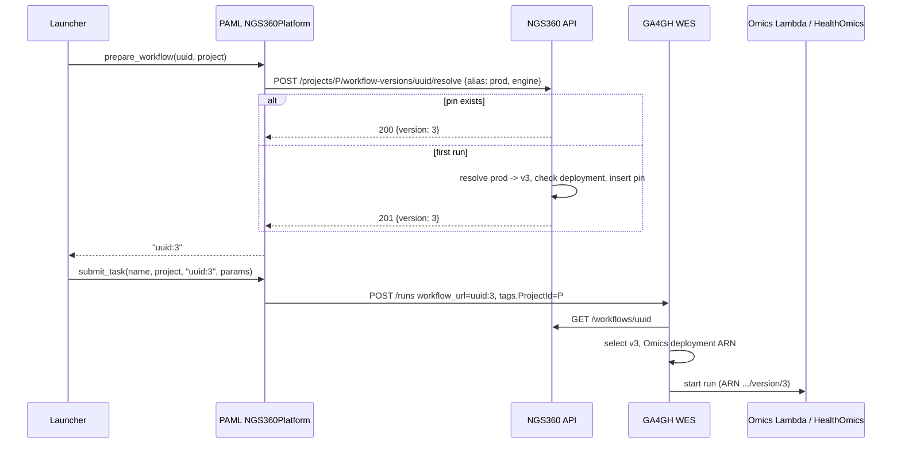

# Project Workflow Version Pinning (NGS360 platform)

Design and development plan for running a project with the same workflow versions every time it is processed on the NGS360 platform (GA4GH WES + AWS HealthOmics).

**Status:** Draft, for review

## Overview

- **Problem:** On NGS360, a project can be processed many times: launcher re-runs, or a new batch of samples arriving weeks later. Meanwhile we keep publishing new workflow versions (1, 2, 3, ...) and moving the `prod` alias forward. Today every run picks up the highest version that exists at that moment, so samples in one project can end up processed by different pipeline versions.
- **Goal:** The first time a project runs a workflow on NGS360, record the version that is `prod` at that moment. Every later run of that workflow for that project uses the recorded version, even after `prod` has moved on.
- **Scope:** Only the NGS360 platform. SevenBridges and Arvados behaviour must not change.
- **Non-goals:**
  - Pinning on SBG or Arvados. Those platforms already pin implicitly, because the launcher copies the app or workflow into the platform project once and reuses that copy.
  - Changing how workflow versions or aliases are published.
  - Getting the NGS360 *create-project* action to start launchers. `ActionPlatform` has no NGS360 option yet; that is tracked separately.

## Systems involved

| System | Repo | Role in this feature | Planned changes |
|---|---|---|---|
| NGS360 API server | `APIServer` | Hosts workflows, versions, `prod` aliases and Omics deployments. Becomes the owner of project pins. | **Changes:** new `projectworkflowversion` table and migration; new `/projects/{id}/workflow-versions` routes (resolve, read, override, delete); tests and docs. Existing workflow, alias, deployment and action routes are unchanged. |
| GA4GH WES service | `GA4GH-WES-API-Service` | Accepts runs and resolves `workflow_url` to an Omics workflow. Already understands `<workflow_uuid>:<version>` and records `resolved_workflow_version`. | **No change required.** Optional: return `resolved_workflow_version` in `GET /runs/{id}`; clean up the unused `workflow_version` field in the Lambda payload; treat numeric suffixes as version numbers before aliases (Phase 5). |
| Omics Run Event Processor | `NGS360-Omics-Run-Event-Processor` | Starts the Omics run from the deployment ARN. | **No change.** |
| PAML (`cwl_platform`) | `PAML` | Platform abstraction used by the launchers. Decides which workflow identifier a project submits with. | **Changes:** new abstract method `prepare_workflow(src_workflow, project)` in the base class; SBG and Arvados implement it by calling their existing `copy_workflow` (behaviour unchanged); `NGS360Platform.prepare_workflow` resolves the pin; pinning is always on, always resolves `prod`, and always targets the `AWSHealthOmics (us-east)` engine (no new settings); auth header on NGS360 API calls. `copy_workflow` is untouched and keeps its meaning on every platform. |
| Pipeline launchers | `WES-Launcher-new`, `WGS-Launcher-new`, `RNA-Seq-Launcher` (10X later) | Process the samples in a project, preparing every workflow for the project before submitting. | **Small changes:** bump the PAML version; switch the `copy_workflows()` helper from `platform.copy_workflow(...)` to `platform.prepare_workflow(...)` (one line); log the resolved versions. No changes to SBG or Arvados configs, and no platform-specific code. |

## Current behaviour (as of 2026-10-12)

What happens today when a launcher runs on NGS360:

1. The launcher config holds a **bare NGS360 workflow UUID** for each workflow, e.g. `WES-Launcher-new/launcher/src/pipeline_config.py` and `WGS-Launcher-new/launcher/src/pipeline_config.py`. An earlier `:prod` suffix was removed in commit 46f1d28.
2. The launcher calls `platform.copy_workflow(uuid, project)` for each workflow. On NGS360 this is a no-op that returns the UUID unchanged (`PAML/src/cwl_platform/ngs360_platform.py`).
3. PAML `submit_task` posts `POST /runs` to WES with `workflow_url=<uuid>` and `tags.ProjectId=<P-...>`.
4. WES `_select_version` (`workflow_submission_service.py`) has three cases:
   - **No suffix:** it takes the highest version number. Note that this is the newest version, not `prod`.
   - **`:<alias>`:** it uses the version the alias points to.
   - **`:<n>`:** it uses version *n*.
5. WES `_select_deployment` takes that version's newest deployment for engine `AWSHealthOmics (us-east)` and passes its `external_id` (an Omics version ARN) to the Lambda.
6. WES stores `workflow_runs.resolved_workflow_version = "<uuid>:<version>"`. This is the only record of which version ran, and the `GET /runs/{id}` response does not return it.

Things to note:

- The alias actually in use is **`prod`**. The `ngs360-push-workflows` Makefile target sets it, and only docstrings say `production`. This design always pins from `prod`. Using any other version is a deliberate manual change (see below).
- In the API server an alias is a single mutable pointer with no history. Once `prod` moves, the old target is gone, so the API alone cannot tell which version a project ran last month.
- The launchers reuse completed tasks by task name **regardless of workflow version** (WES launcher comment around `launcher.py:630`). Pinning makes that reuse consistent: a re-run either reuses a result or recomputes it with the same version.

## Design

### Behaviour

When the launcher prepares a workflow `W` for project `P` on NGS360:

```
if the launcher config already gives an explicit version or alias ("<uuid>:<x>"):
    use it unchanged (explicit wins, no pin is read or written)
elif a pin exists for (P, W, engine):
    use "<uuid>:<pinned version>"
else:
    resolve alias "prod" for W  -> version N
    check that version N has a deployment for the engine
    store the pin (P, W, engine) -> N
    use "<uuid>:N"
```

The read-or-create step is a **single atomic API call**. Two launchers starting for the same project at the same time therefore end up with the same pin.

### Where the logic lives

**The table and the resolve logic go in the API server. The hook is a new PAML method, `prepare_workflow`, which every platform implements and only `NGS360Platform` uses to resolve a pin.**

Reasons:

- **SBG and Arvados are untouched by construction.** Every launcher already prepares each workflow through one helper, `copy_workflows()`, before submitting. On SBG and Arvados, preparing a workflow means copying the app into the project, which is how those platforms already pin per project. The SBG and Arvados `prepare_workflow` keep doing exactly that by calling `copy_workflow`. Only NGS360's resolves a pin. No launcher needs `if platform == "NGS360"` branches.
- **Method names stay truthful.** Putting pin logic inside `copy_workflow` would make the name misleading on NGS360, where nothing is copied. `prepare_workflow` means "make this workflow usable in this project and return the identifier to submit with", which is accurate on every platform. `copy_workflow` keeps its meaning and stays a no-op on NGS360.
- **The API server already owns workflows, versions, aliases and projects.** A pin table there can use foreign keys to `workflow`, `workflowversion` and `project`, and can validate deployments. WES knows nothing about NGS360 projects.
- **WES needs no change.** It already accepts `<uuid>:<n>` and records `resolved_workflow_version`.

Alternatives considered:

| Option | Why not chosen |
|---|---|
| Resolve the pin inside WES `_select_version` | Every WES submission would need a new project lookup against NGS360, and WES would become stateful about NGS360 projects. It would also apply to any WES client, not just the launchers, which makes it harder to override per project. |
| Store the pin as a `ProjectAttribute` key/value (e.g. `workflow_version:<uuid>=3`) | No foreign keys, no type checking, no atomic read-or-create, and attribute keys are matched case-insensitively. It works as a stopgap but is fragile. |
| Infer the version from past WES runs (`resolved_workflow_version`) | It is not authoritative. It cannot represent a deliberate upgrade, and it is empty until a run has been submitted. It is still useful for backfill (see the rollout section). |

### Data model (API server)

New table `projectworkflowversion`, following the existing lower-case naming. Pins are **per workflow**, not per pipeline: each workflow a launcher uses gets its own row.

| Field | Type | Required | Description |
|---|---|---|---|
| `id` | UUID | Yes | Primary key |
| `project_id` | str | Yes | Business key `P-YYYYMMDD-NNNN`; FK to `project.project_id` |
| `workflow_id` | UUID | Yes | FK to `workflow.id` |
| `version` | int | Yes | The pinned version number (1, 2, 3, ...), i.e. `workflowversion.version`. Passed to GA4GH WES as `workflow_url=<workflow_id>:<version>` |
| `engine` | str | Yes | FK to `platform.name`, e.g. `AWSHealthOmics (us-east)`. Scopes the pin to the NGS360/Omics execution engine |
| `pinned_from_alias` | str | No | The alias resolved when the pin was created (e.g. `prod`). Null for a manual pin |
| `created_at` / `created_by` | datetime / str | Yes | Who or what created the pin (the launcher's user) |
| `updated_at` / `updated_by` | datetime / str | No | Set when the pin is changed by an explicit override |

**Constraints:**

- `UNIQUE(project_id, workflow_id, engine)`, named `uq_project_workflow_engine`.
- Composite FK `(workflow_id, version)` → `workflowversion(workflow_id, version)`, which references the existing `uq_workflow_version` unique key. The pin can never name a version that doesn't exist, and a pinned version can't be deleted.

**Why store the version number rather than the `workflowversion.id` UUID:** the number is what GA4GH WES takes (`<workflow_id>:<version>`), so PAML can submit with it directly and a raw query of the table is readable. The number is a stable identifier: `(workflow_id, version)` is unique, numbers are assigned as max+1, and there is no route to delete a version, so a number is never reused. The composite FK gives the same integrity as a UUID FK.

The **per-run** history (which version each sample actually ran with) already lives in WES `workflow_runs.resolved_workflow_version`. No history table is proposed for the first version. If audit of overrides becomes a requirement, add a `projectworkflowversionevent` table later.

### API (API server)

All routes sit under `/projects/{project_id}/workflow-versions`.

#### Resolve (get or create) a pin

This is the endpoint the launcher calls.

```
POST /projects/{project_id}/workflow-versions/{workflow_id}/resolve
```

```json
{ "engine": "AWSHealthOmics (us-east)", "alias": "prod" }
```

Response, 200 if the pin already existed and 201 if it was just created:

```json
{
  "project_id": "P-20261012-0001",
  "workflow_id": "b6fd2ade-...",
  "version": 3,
  "engine": "AWSHealthOmics (us-east)",
  "external_id": "arn:aws:omics:...:workflow/1234567/version/3",
  "pinned_from_alias": "prod",
  "created": true,
  "created_at": "...",
  "created_by": "svc-launcher"
}
```

How it works:

- It inserts the row and relies on the unique constraint. On a unique violation it re-reads and returns the existing row, which handles concurrent launchers.
- It looks up `external_id` from `workflowdeployment` at read time and returns it for logging only. WES still does its own deployment selection.

Errors:

- 404: the project or workflow is not found, or the alias is not set for the workflow and no pin exists yet.
- 422: the alias's version has no deployment for `engine`. Refusing here avoids pinning a version that cannot run.

#### Read pins

```
GET /projects/{project_id}/workflow-versions?engine=
GET /projects/{project_id}/workflow-versions/{workflow_id}?engine=
```

These return the list, or a single pin. The single-pin route returns 404 if the workflow is not pinned.

#### Override a pin (deliberate upgrade or downgrade)

```
PUT /projects/{project_id}/workflow-versions/{workflow_id}
```

```json
{ "engine": "AWSHealthOmics (us-east)", "version": 4 }
```

This sets `updated_at`/`updated_by` and clears `pinned_from_alias`. It returns 422 if the version has no deployment for the engine.

#### Remove a pin

```
DELETE /projects/{project_id}/workflow-versions/{workflow_id}?engine=
```

This returns 204. The next run pins to the current `prod`.

**Permissions:**

| Route | Proposed guard | Reason |
|---|---|---|
| `resolve` | `require_project_permission(PROJECT_SUBMIT_ACTION)` | Anyone allowed to process the project must be able to pin on first run |
| `GET` | Project read permission | Read-only |
| `PUT` / `DELETE` | `WORKFLOW_CREATE`, the same permission as registering a workflow | Whoever can register workflows can change a project's pin manually. Changing a pin changes scientific output, so it is not open to every user |

### PAML change

> **⚠️ Design choice: reuse `copy_workflow()` or add `prepare_workflow()`**
>
> Both options produce the same NGS360 behaviour and leave SevenBridges and Arvados behaviour unchanged. They differ in naming and in how much code changes.
>
> | | **Option A: reuse `copy_workflow()`** | **Option B: add `prepare_workflow()`** (proposed below) |
> |---|---|---|
> | PAML change | Put the pin logic in `NGS360Platform.copy_workflow` | Declare an abstract `prepare_workflow` in the base class; each platform implements it |
> | SBG / Arvados code | No change | A short `prepare_workflow` that calls the existing `copy_workflow`; behaviour unchanged |
> | Launcher code | **No change**, only a PAML version bump | One-line change in each launcher's `copy_workflows()` helper |
> | Naming | Misleading on NGS360: nothing is copied, a pin is resolved | Accurate on every platform; `copy_workflow` keeps its meaning |
> | Rollout | Every launcher gets pinning as soon as it bumps PAML | Each launcher opts in when it switches to `prepare_workflow` |
>
> Option A is the smallest change. Option B costs a one-line launcher edit and keeps the method names truthful. The rest of this document assumes Option B. Switching to Option A only means moving the NGS360 `prepare_workflow` body into `copy_workflow`, and dropping the SBG/Arvados additions and the launcher edit (task 3.2 and part of 4.1).

New abstract method on the base class, `base_platform.py`. It has no default, so each platform states what "prepare" means in its own file:

```python
@abstractmethod
def prepare_workflow(self, src_workflow, project):
    """Make src_workflow usable in project and return the workflow identifier to submit with."""
```

SevenBridges (`sevenbridges_platform.py`) and Arvados (`arvados_platform.py`) each add an explicit implementation that calls their existing `copy_workflow`, so their behaviour is identical to today:

```python
def prepare_workflow(self, src_workflow, project):
    """Copy the workflow into the project if it isn't there yet and return the project copy.
    Reusing the project copy is what keeps the version fixed per project on this platform."""
    return self.copy_workflow(src_workflow, project)
```

The NGS360 implementation, in `ngs360_platform.py`. Its `copy_workflow` stays the no-op it is today:

```python
def prepare_workflow(self, src_workflow, project):
    if ":" in src_workflow:
        return src_workflow                      # explicit version/alias: unchanged, no pin read or written
    pin = self._resolve_workflow_pin(            # POST .../workflow-versions/{uuid}/resolve
        project_id=project["project_id"],
        workflow_id=src_workflow,
        alias="prod",                            # always pin from prod
        engine=OMICS_ENGINE,                     # "AWSHealthOmics (us-east)", module constant
    )
    logger.info("Workflow %s pinned to v%s for %s (%s)", src_workflow, pin["version"],
                project["project_id"], "new pin" if pin["created"] else "existing pin")
    return f"{src_workflow}:{pin['version']}"
```

Pinning is always on and always pins from `prod`. There is no setting to turn it off or to pin from another alias. Running a project with a different version is a deliberate manual change, just as on SBG and Arvados, where you replace the workflow copy in the project. On NGS360 there are two ways:

- Put an explicit `uuid:<n>` in the launcher config for a one-off run. This bypasses the pin and writes nothing.
- Change the project's pin with `PUT /projects/{id}/workflow-versions/{workflow_id}` (admin). Every later run uses the new version. This needs the same permission as registering a workflow.

The engine is fixed too: a module constant `OMICS_ENGINE = "AWSHealthOmics (us-east)"`, the platform name exactly as the code uses it (WES deployment selection and the API server's Omics registration), not the `AWS HealthOmics (us-east-1)` spelling in older docs. PAML gets no new settings or environment variables. `--platform NGS360` currently runs only on HealthOmics us-east-1. If NGS360 gains more engines or regions, the engine becomes configuration at that point.

Related PAML fix: the NGS360 API calls (`get_project_by_id`, `get_project_by_name`, file upload) currently send **no auth header**. The resolve call must send `Authorization: Bearer $NGS360_AUTH_TOKEN`. Add the header to all NGS360 API calls in the same change.

`get_tasks_by_name(workflow=...)` compares the literal `workflow_url`. The launchers don't pass `workflow=`, so the change from `uuid` to `uuid:N` doesn't affect task reuse. Add a test to keep it that way.

### Launcher changes

These are small, and the same for each launcher:

- Bump the PAML pin to the release that contains the change.
- In the `copy_workflows()` helper (e.g. `WES-Launcher-new/launcher/src/launcher.py`), call `platform.prepare_workflow(...)` instead of `platform.copy_workflow(...)`. On SBG and Arvados the result is identical.
- Write the resolved `workflow -> version` map to the launcher log. The authoritative record is the pin table in the API server.

### Sequence



### SevenBridges and Arvados: why behaviour doesn't change

- PAML: `sevenbridges_platform.py` and `arvados_platform.py` each gain a `prepare_workflow` that only calls their existing, unmodified `copy_workflow`, so they return exactly what they return today. `base_platform.py` only gains the abstract declaration.
- Launchers: the switch from `copy_workflow` to `prepare_workflow` is a no-op on SBG and Arvados. There is no platform-specific code. The SBG and Arvados config entries hold platform app or workflow IDs, which never reach the new code.
- API server: the new table and routes are additive. Existing workflow, alias, deployment and action routes keep the same contract.
- WES: unchanged.

### Edge cases

| Case | Behaviour |
|---|---|
| `prod` alias not set on first run | `resolve` returns 404 and the launcher fails fast with a clear message. It does not fall back to "latest". |
| The `prod` version has no Omics deployment | 422 and no pin is written. |
| A pinned version's deployment is deleted later | WES fails at submission (no deployment for the engine). The fix is to redeploy that version or override the pin. Document this in the runbook. |
| A new workflow is added to the launcher after the project was first run | That workflow gets pinned on its first use, to `prod` at that time. Its pin is independent of the project's other pins. |
| Concurrent launchers for the same project | The unique constraint plus re-read means both get the same pin. |
| Someone wants to test a new version on an existing project | Put `uuid:<n>` in the launcher config. This bypasses the pin and writes nothing. |
| A project's first-ever run uses an explicit `uuid:<n>` | No pin is written. If the config later goes back to a bare ID, that run pins the `prod` of that moment, not `<n>`. To keep `<n>` for the project, `PUT` the pin. |
| Deliberate upgrade of a project | `PUT` the pin (admin). Samples run before the upgrade keep their reused results unless they are re-run explicitly. |

## Behaviour change and rollout

- **This changes NGS360 behaviour for new runs:** first runs use `prod` instead of "highest version". That is the intended outcome, but announce it.
- **Projects processed on NGS360 before rollout have no pin.** Without action, their next run pins to the current `prod`, which may differ from what they ran before. Options:
  1. **Backfill (recommended).** A one-off script reads WES `workflow_runs` grouped by `(project, workflow_uuid)`, takes the version from `resolved_workflow_version` of the most recent successful run, and writes pins with `pinned_from_alias = NULL` and `created_by = "backfill"`. Flag any project that ran more than one version of a workflow for manual review (see open question 1).
  2. Accept pinning to current `prod` on the next run. Simpler, but projects may silently mix versions.
- Rollout order:
  1. Deploy the API server and run the migration.
  2. Backfill.
  3. Release PAML.
  4. Bump each launcher's PAML pin.

  Each step is backward compatible. A launcher on old PAML, or one that still calls `copy_workflow`, sends bare UUIDs and gets today's behaviour, so each launcher can opt in on its own schedule.
- There is no kill switch. To get today's behaviour back, a launcher goes back to calling `copy_workflow` (or to the previous PAML version) and is redeployed.

## Development plan

### Phase 1: API server (`APIServer`)

| # | Task | Files |
|---|---|---|
| 1.1 | Add the `ProjectWorkflowVersion` SQLModel and public/request schemas (`ProjectWorkflowVersionPublic`, `...ResolveRequest`, `...SetRequest`) | `api/project/models.py`, or a new `api/project/workflow_versions/` module |
| 1.2 | Register the model in Alembic and add a migration that creates the table, the unique constraint and the composite FK `(workflow_id, version)` → `workflowversion(workflow_id, version)`. Write a docstring with the rationale and MySQL notes, as recent migrations do | `alembic/env.py`, `alembic/versions/<rev>_add_project_workflow_version_table.py` |
| 1.3 | Service functions: `resolve_project_workflow_version` (atomic get-or-create; alias resolution; deployment check), `get_*`, `set_*` (override), `delete_*` | `api/project/services.py`, or the new module's `services.py`, reusing alias and deployment lookups from `api/workflow/services.py` |
| 1.4 | Routes with RBAC guards | `api/project/routes.py` |
| 1.5 | Tests: first resolve creates (201) and second returns existing (200); alias moved after pin → pin unchanged; alias missing → 404; no deployment → 422; concurrent insert path (IntegrityError → re-read); override and delete; permission checks | `tests/api/test_project_workflow_versions.py` |
| 1.6 | Update route coverage: add guards and bump the `len(GUARDED)` count | `tests/test_route_coverage.py` |
| 1.7 | Docs: add the table to the ER diagram and an endpoints section | `docs/WORKFLOWS_AND_PIPELINES.md`, `docs/ER_DIAGRAM.md` |
| 1.8 | Optional: MCP tools `resolve_project_workflow_version` and `list_project_workflow_versions` | `mcp-server` |

### Phase 2: Backfill

| # | Task |
|---|---|
| 2.1 | Script that reads WES `workflow_runs` (`project`, `workflow_url`, `resolved_workflow_version`, `state`) and writes pins via the API |
| 2.2 | Dry-run report: projects with more than one version per workflow, for manual decision |
| 2.3 | Run in dev, then prod |

### Phase 3: PAML (`PAML`)

| # | Task | Files |
|---|---|---|
| 3.1 | Add an auth header to all NGS360 API calls | `src/cwl_platform/ngs360_platform.py` |
| 3.2 | Declare abstract `Platform.prepare_workflow` in the base class; implement it in SBG and Arvados as a call to their existing `copy_workflow` | `src/cwl_platform/base_platform.py`, `sevenbridges_platform.py`, `arvados_platform.py` |
| 3.3 | Implement `NGS360Platform.prepare_workflow` and `_resolve_workflow_pin`; leave NGS360 `copy_workflow` as a no-op | `src/cwl_platform/ngs360_platform.py` |
| 3.4 | Unit tests with a mocked API: pin created, pin reused, explicit `uuid:x` bypass, 404/422 surfaced as clear errors, `get_tasks_by_name` task reuse unaffected by the `uuid:N` form. Also check that SBG and Arvados `prepare_workflow` returns the same as `copy_workflow`, and that existing `copy_workflow` tests are unchanged | `tests/` |
| 3.5 | Release a new PAML version | |

### Phase 4: Launchers

| # | Task | Repo |
|---|---|---|
| 4.1 | Bump PAML; switch `copy_workflows()` to call `platform.prepare_workflow`; verify that all NGS360 workflows pass through it and that the returned IDs are what gets submitted | `WES-Launcher-new`, `WGS-Launcher-new` |
| 4.2 | Log the resolved versions | same |
| 4.3 | End-to-end test in dev, in four steps: (1) first run pins `prod`; (2) move `prod`; (3) re-run and confirm the old version is used (check WES `resolved_workflow_version`); (4) add a new samplesheet batch and confirm the old version is used | same |
| 4.4 | Same for RNA-Seq once `add_omics_support` is merged, and 10X once it supports NGS360 | `RNA-Seq-Launcher`, `10X-Launcher-new` |

### Phase 5: Optional WES improvements (not required)

| # | Task |
|---|---|
| 5.1 | Return `resolved_workflow_version` in `GET /runs/{id}` so launchers and support can verify the version without DB access |
| 5.2 | Drop or correct the `workflow_version` field in the Lambda payload, which is taken from `workflow_params` and never read |
| 5.3 | In `_select_version`, treat an all-digit suffix as a version number before trying it as an alias. Today `<uuid>:5` is looked up as an alias first, so an alias literally named `5` would shadow version 5. Alternatively, forbid numeric alias names in the API server |

### Estimate

| Phase | Effort |
|---|---|
| 1 | 3–4 days |
| 2 | 1 day |
| 3 | 2 days |
| 4 | 1–2 days per launcher, including the end-to-end test |
| 5 | 0.5 day |

## Open questions

1. **Backfill policy for projects that already ran several versions of the same workflow on NGS360.** After rollout a project holds exactly one version per workflow, but history may already be mixed. Options:
   - Pin the version of the most recent successful run.
   - Pin the version used by most samples.
   - Leave the project unpinned and flag it for manual review before its next run.

   Each option has a cost. Whichever version is pinned, earlier samples run on other versions remain mixed unless they are re-run.
