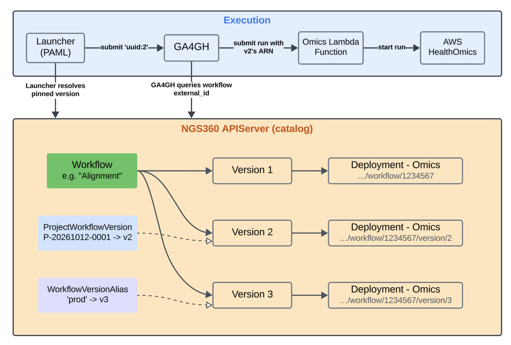
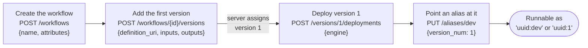
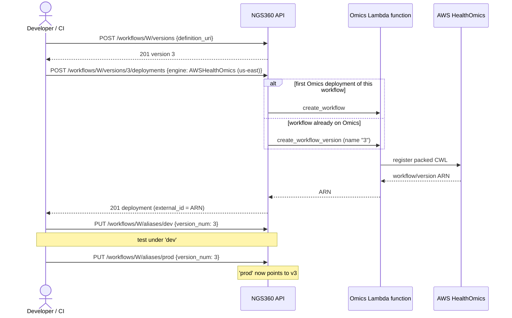
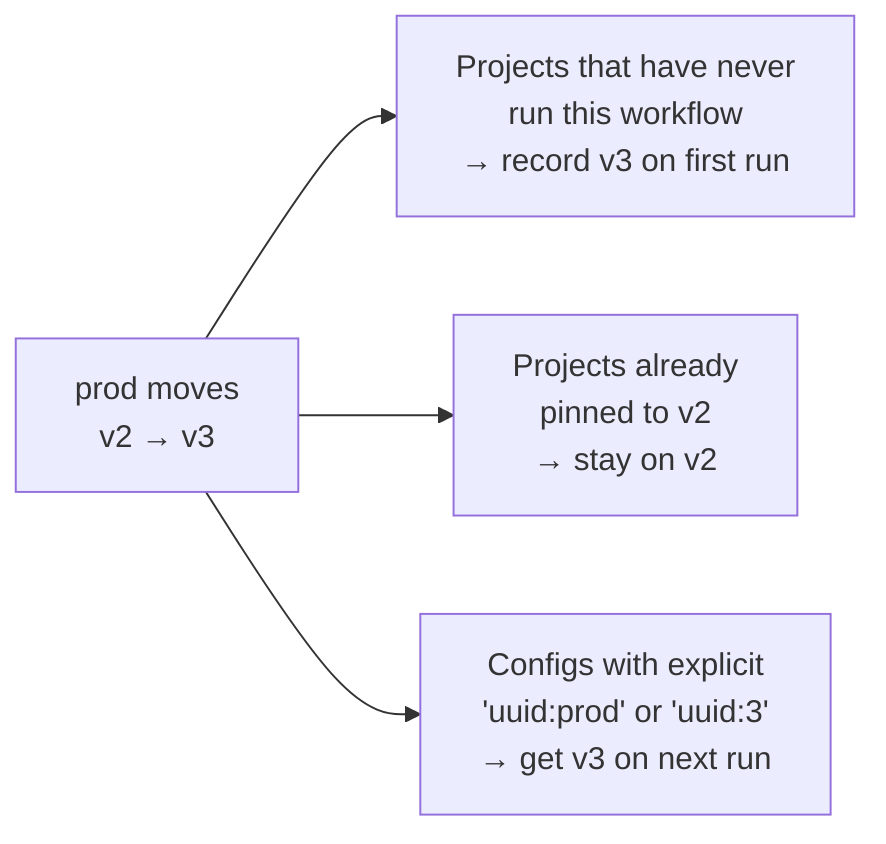
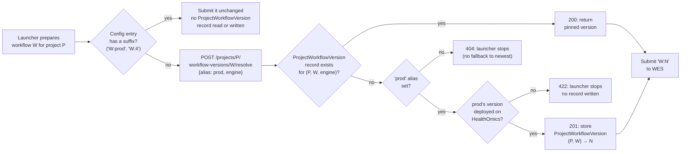
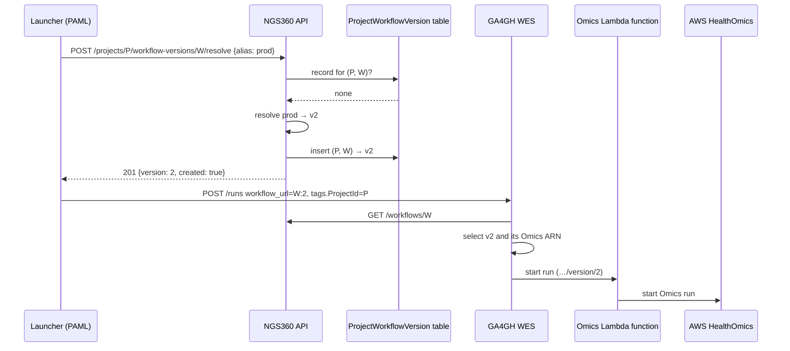
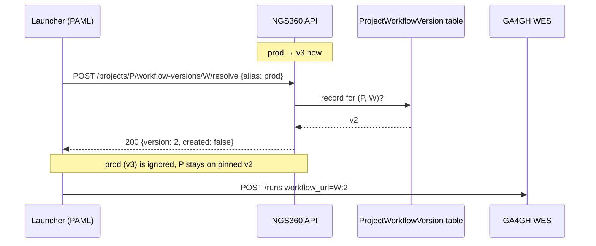
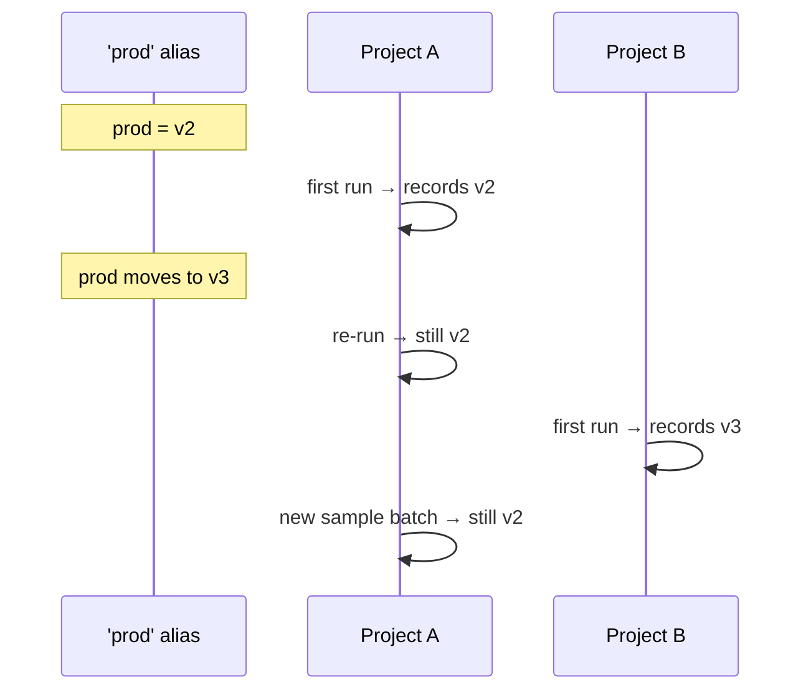
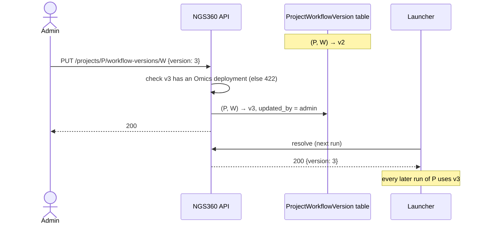
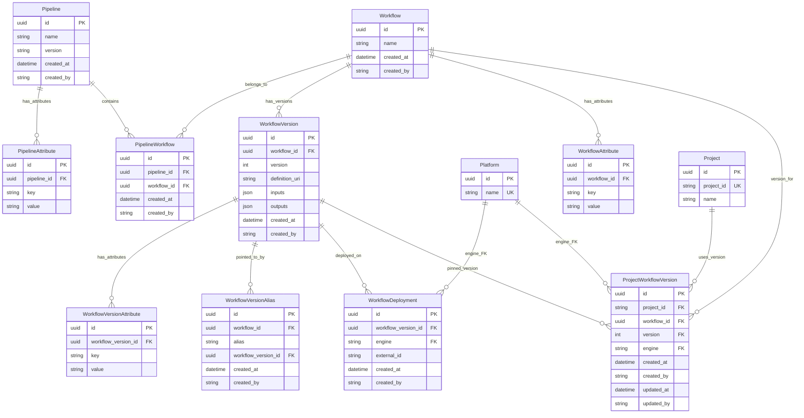

# Workflows & Pipelines

This document describes the Workflow and Pipeline systems — how workflows are registered, versioned, deployed and run on NGS360, and how a project stays on the same workflow version across runs.

## Table of Contents

- [The big picture](#the-big-picture)
- **How it works**
  - [1. Registering a new workflow](#1-registering-a-new-workflow)
  - [2. Releasing a new version](#2-releasing-a-new-version)
  - [3. Running a launcher on a project](#3-running-a-launcher-on-a-project)
  - [4. First run of a project](#4-first-run-of-a-project-no-pinned-version-yet)
  - [5. Re-running a project](#5-re-running-a-project-pinned-version-exists)
  - [6. Changing a project's version](#6-changing-a-projects-version)
  - [7. Edge cases](#7-edge-cases)
- **Reference**
  - [Entity Relationship Diagram](#entity-relationship-diagram)
  - [Which id do I use?](#which-id-do-i-use)
  - [API endpoints](#api-endpoints)
  - [Database Models](#database-models)
  - [Source files](#source-files)

## The big picture

The API server is the workflow **catalog**: it records what a workflow is, which versions exist, where each version is registered, and (new) which version each project uses.

The launcher first asks the catalog for the project's pinned version (v2), then submits `uuid:2` to WES. WES reads the workflow, picks version 2's Omics deployment, and passes its ARN to the Omics Lambda function, which starts the run on HealthOmics.

| Concept | What it is |
|---------|------------|
| **Workflow** | The logical identity, e.g. "Alignment". Has no definition of its own |
| **Version** | One revision of a workflow, with its own definition file (`definition_uri`). Numbered 1, 2, 3, … by the server |
| **Deployment** | "What is this version called on that platform?" — an `external_id` per (version, platform) |
| **Alias** | A movable name such as `prod` or `dev` that points to one version |
| **ProjectWorkflowVersion** | The version a project uses for a workflow on NGS360. Set once on first run, then reused |

## How it works

### 1. Registering a new workflow

Getting a workflow from scratch to runnable. A version is not runnable until it is deployed.

What happens at each step:

- **Workflow** — creates the identity only. There is nothing to run yet.
- **Version** — the server assigns the next number (`MAX(version) + 1`, under a row lock so concurrent creates cannot collide). You cannot choose or reuse a number. Recording `inputs`/`outputs` and a `git_commit` attribute is optional but recommended.
- **Deployment** — makes the version runnable on one platform. See [step 2](#2-releasing-a-new-version) for what happens on HealthOmics.
- **Alias** — optional, but it lets callers say `dev` instead of hardcoding `1`.

Things to know:

- The deployment's `engine` must be an already registered platform (`Arvados`, `SevenBridges`, `AWSHealthOmics (us-east)`). Names are compared literally, so check `GET /platforms` rather than guessing the spelling.
- Deploying and aliasing are independent. An alias can point at a version that was never deployed; anything that resolves it will then fail at the deployment lookup.

### 2. Releasing a new version

The everyday path: a tool changed and the new revision needs to reach production without disturbing what is already running.

What happens at each step:

1. **New version** — existing versions are untouched. Whatever `prod` points at keeps serving.
2. **Deploy** — for HealthOmics you can leave out `external_id` and the server registers the workflow for you. The first deploy creates the Omics workflow; later deploys add Omics versions to it. Only the `git_commit`, `git_repo` and `git_ref` attributes plus `ngs360_env` are sent as Omics tags. For every other platform you register the workflow there yourself and record the id it gave you; NGS360 never contacts those platforms.
3. **Test** — point `dev` at the new version. `prod` is unchanged.
4. **Promote** — point `prod` at it. Setting an alias is an upsert, so this moves the pointer rather than creating a second one.

**Rolling back** is step 4 with the previous number. Nothing is deleted, and the old version's deployment is still there.

**What promotion does and does not affect**:

### 3. Running a launcher on a project

Each launcher prepares every workflow for the project before submitting, by calling `platform.prepare_workflow(workflow_id, project)`. What "prepare" means depends on the platform:

| Platform | `prepare_workflow` does | How the version stays fixed per project |
|----------|-------------------------|-----------------------------------------|
| SevenBridges | Copies the app into the project (unchanged behaviour) | The project keeps reusing its copy |
| Arvados | Copies the workflow into the project (unchanged behaviour) | The project keeps reusing its copy |
| **NGS360** | Looks up the project's pinned version in the NGS360 ProjectWorkflowVersion table | The ProjectWorkflowVersion table |

On NGS360 the decision is:

Each workflow in a launcher gets its own pinned version: a WGS launcher with five workflows has five ProjectWorkflowVersion records for the project.

### 4. First run of a project (no pinned version yet)

Project `P` runs workflow `W` for the first time. `prod` currently points to version 2.

### 5. Re-running a project (pinned version exists)

Later, `prod` has moved to version 3. Project `P` gets a new batch of samples, or its launcher is re-run. `P` still runs its pinned version 2.

How this plays out across projects over time:

### 6. Changing a project's version

Pinned versions never move on their own. Changing one is always deliberate.

> **Just trying another version once?** Put the version in the launcher config, e.g. `uuid:3`. That run uses version 3; the project's pinned version is bypassed and stays unchanged.

To move the project to another version for this and all future runs, force an upgrade:

Things to know:

- To reset a project to whatever `prod` points at now, `DELETE /projects/P/workflow-versions/W` instead. The next run records the current `prod`.
- If a project's *first* run used an explicit `W:5`, no ProjectWorkflowVersion record is written. Going back to a bare id later records whatever `prod` is at that time, not 5. To keep 5, `PUT` the record.

### 7. Edge cases

| Situation | What happens | Fix |
|-----------|--------------|-----|
| `prod` is not set when a project first runs `W` | `resolve` returns `404`; launcher stops | Set the `prod` alias |
| `prod`'s version has no HealthOmics deployment | `resolve` returns `422`; no ProjectWorkflowVersion record written | Deploy that version, or move `prod` |
| A pinned version's deployment is deleted later | WES rejects the submission (no deployment) | Redeploy that version, or override the pinned version |
| Reference suffix matches no alias and no version | WES: alias/version not found | Fix the config entry |
| Workflow has no versions | WES: no versions found | Add a version |
| Reference has more than one `:` | WES: malformed reference | Fix the config entry |
| HealthOmics deploy returns `504` | Registration probably succeeded on AWS, but NGS360 didn't record it | Check Omics, then record with an explicit `external_id`; don't redeploy |

**Projects run before this change ships** have no ProjectWorkflowVersion record. Unless they are backfilled from WES run history (`resolved_workflow_version`), their next run records whatever `prod` is at that time, which may differ from what they ran before.

## Reference

### Entity Relationship Diagram

### Which id do I use?

API responses contain several identifiers and only some are accepted back as input, which is a common source of confusion.

- **To run a workflow, use the workflow id** (`workflow.id`) — optionally suffixed with an alias or version number. Never a version id, a deployment id, or an `external_id`.
- **To address a version, use its number, not its UUID.** Version ids are returned inside version summaries, alias responses and deployment responses, but no endpoint anywhere accepts one. Version numbers are small integers starting at 1 and scoped to their workflow, so `version 3` only means something alongside a workflow id.
- **Platforms are referenced by name** (`platform.name`) in the `engine` field. `platform.id` exists but the workflow API never uses it.
- **A deployment id is only good for deleting that deployment.** It addresses nothing else.
- **ProjectWorkflowVersion records are addressed by project business key and workflow id** (`P-YYYYMMDD-NNNN` and `workflow.id`).
- **`external_id` is normally an output** — you read it to learn what a version is called on its platform. You supply it only when you registered the workflow there yourself. The GA4GH WES service calls this same value the **engine id**.

Unrelated despite the similar look: an `ngs360://<file-id>` inside a `definition_uri` is a **file** id from the files API.

### API endpoints

All paths are under `/api/v1` and require authentication; the caller's username is recorded as `created_by`. Workflows and versions are addressed by workflow id and **version number** (not version UUID), platforms by **name**.

#### Workflows

| Method | Path | Body / params | Notes |
|--------|------|---------------|-------|
| `POST` | `/workflows` | `name`, optional `attributes` | Creates the workflow identity only |
| `GET` | `/workflows` | `page`, `per_page`, `sort_by`, `sort_order` | Paginated; includes attributes, version summaries and aliases |
| `GET` | `/workflows/{workflow_id}` | | Workflow with versions (each with its deployments) and resolved aliases, in one response |

#### Versions

| Method | Path | Body / params | Notes |
|--------|------|---------------|-------|
| `POST` | `/workflows/{workflow_id}/versions` | `definition_uri`; optional `attributes`, `inputs`, `outputs` | Server assigns the next `version` number. `400` on duplicate attribute keys |
| `GET` | `/workflows/{workflow_id}/versions` | | Newest first |
| `GET` | `/workflows/{workflow_id}/versions/{version_num}` | | Includes deployments, attributes, `inputs` and `outputs` |

#### Aliases

| Method | Path | Body / params | Notes |
|--------|------|---------------|-------|
| `PUT` | `/workflows/{workflow_id}/aliases/{alias}` | `version_num` | Creates or moves the alias (upsert) |
| `GET` | `/workflows/{workflow_id}/aliases` | optional `alias` | With `alias`, returns 0 or 1 items |
| `DELETE` | `/workflows/{workflow_id}/aliases/{alias}` | | `204`. Removes only the pointer |

#### Deployments

| Method | Path | Body / params | Notes |
|--------|------|---------------|-------|
| `POST` | `/workflows/{workflow_id}/versions/{version_num}/deployments` | `engine`, `external_id` | `engine` must be a registered platform. `external_id` may be omitted for `AWSHealthOmics (us-east)` (see below). `409` if the version already has a deployment on that engine |
| `GET` | `/workflows/{workflow_id}/deployments` | optional `alias`, `engine` | Across all versions; `alias` narrows to that version's deployments |
| `GET` | `/workflows/{workflow_id}/versions/{version_num}/deployments` | optional `engine` | One version's deployments |
| `DELETE` | `/workflows/{workflow_id}/versions/{version_num}/deployments/{deployment_id}` | | `204`. Removes NGS360's record only; nothing is deregistered on the platform |

`external_id` is whatever the platform calls the version, e.g. an Arvados workflow UUID (`xngs1-7fd4e-…`), a SevenBridges app id (`owner/project/app`), or an Omics ARN (`…/workflow/1234567` for the first version, `…/workflow/1234567/version/3` after that). For every platform except HealthOmics, NGS360 never contacts the platform; you register there yourself and record the id.

**Deploying to HealthOmics without an `external_id`.** The server registers the workflow through the Omics Lambda function and stores the returned ARN:

- The first deployment of a workflow creates the Omics workflow; later versions are added to it, named by the NGS360 version number.
- `definition_uri` must resolve to S3 (`s3://…`, or an S3-backed `ngs360://<file-id>`).
- Only the `git_commit`, `git_repo` and `git_ref` attributes are sent as Omics tags, plus `ngs360_env`.
- Settings: `OMICS_REGISTER_WORKFLOW_LAMBDA` (Lambda name, required) and `OMICS_REGISTER_LAMBDA_READ_TIMEOUT` (default `300` seconds).
- Errors: `400` bad `definition_uri`; `502` the Lambda failed (usually invalid CWL); `504` timeout; `401`/`403`/`404`/`500` AWS or Lambda misconfiguration.
- **On `504`, don't redeploy.** The registration has probably finished on AWS. Check with `aws omics list-workflow-versions --workflow-id <id>`, then call this endpoint again with that ARN as `external_id`.

#### Pipelines

| Method | Path | Body / params | Notes |
|--------|------|---------------|-------|
| `POST` | `/pipelines` | `name`; optional `version`, `attributes`, `workflow_ids` | Attribute keys must be unique |
| `GET` | `/pipelines` | `page`, `per_page`, `sort_by`, `sort_order` | Paginated |
| `GET` | `/pipelines/{pipeline_id}` | | Includes attributes and workflow summaries |
| `POST` | `/pipelines/{pipeline_id}/workflows` | query `workflow_id` | `409` if already in the pipeline |
| `DELETE` | `/pipelines/{pipeline_id}/workflows/{workflow_id}` | | `204` |

#### Project workflow versions

`{project_id}` is the project business key (`P-YYYYMMDD-NNNN`). Launchers always use `engine = AWSHealthOmics (us-east)`.

| Method | Path | Body / params | Notes | Permission |
|--------|------|---------------|-------|------------|
| `POST` | `/projects/{project_id}/workflow-versions/{workflow_id}/resolve` | `engine`, `alias` (`prod`) | Returns the existing record (`200`) or resolves the alias and creates one (`201`). `404` if the alias isn't set; `422` if its version has no deployment on `engine`. Safe under concurrent calls | `project:submit_action` |
| `GET` | `/projects/{project_id}/workflow-versions` | optional `engine` | All records for the project | Project read |
| `GET` | `/projects/{project_id}/workflow-versions/{workflow_id}` | optional `engine` | One record; `404` if none | Project read |
| `PUT` | `/projects/{project_id}/workflow-versions/{workflow_id}` | `engine`, `version` | Override to another version. `422` if it has no deployment on `engine` | `workflow:create` |
| `DELETE` | `/projects/{project_id}/workflow-versions/{workflow_id}` | `engine` | `204`. The next run records the current `prod` | `workflow:create` |

### Database Models

Columns in each table. **Required** is `yes` if the caller must supply it, `auto` if the server sets it (`created_by` is the authenticated user), and `no` if it is optional.

#### Workflow

| Column | Type | Required | Description |
|--------|------|----------|-------------|
| `id` | UUID | auto | Primary key |
| `name` | string | yes | Human-readable workflow name |
| `created_at` | datetime | auto | UTC creation time |
| `created_by` | string | auto | Username of the creator |

#### WorkflowAttribute

| Column | Type | Required | Description |
|--------|------|----------|-------------|
| `id` | UUID | auto | Primary key |
| `workflow_id` | UUID | yes | FK → `workflow.id` |
| `key` | string | yes | Attribute name |
| `value` | string | yes | Attribute value |

#### WorkflowVersion

| Column | Type | Required | Description |
|--------|------|----------|-------------|
| `id` | UUID | auto | Primary key |
| `workflow_id` | UUID | yes | FK → `workflow.id` |
| `version` | int | auto | Version number within the workflow, assigned by the server (1, 2, 3, …). Unique per workflow |
| `definition_uri` | string | yes | Workflow definition file (CWL, WDL, Nextflow), as `s3://…` or `ngs360://<file-id>` |
| `inputs` | JSON | no | List of input parameters (`id`, `type`, `required`, `doc`, `default`). `null` if not recorded |
| `outputs` | JSON | no | List of output parameters (`id`, `type`, `doc`). `null` if not recorded |
| `created_at` | datetime | auto | UTC creation time |
| `created_by` | string | auto | Username of the creator |

#### WorkflowVersionAttribute

| Column | Type | Required | Description |
|--------|------|----------|-------------|
| `id` | UUID | auto | Primary key |
| `workflow_version_id` | UUID | yes | FK → `workflowversion.id` |
| `key` | string | yes | Attribute name, e.g. `git_commit` |
| `value` | string | yes | Attribute value |

#### WorkflowVersionAlias

| Column | Type | Required | Description |
|--------|------|----------|-------------|
| `id` | UUID | auto | Primary key |
| `workflow_id` | UUID | yes | FK → `workflow.id`; aliases are scoped per workflow |
| `alias` | string | yes | Alias name, e.g. `prod`, `dev`. Unique per workflow |
| `workflow_version_id` | UUID | yes | FK → `workflowversion.id`; the version the alias points to |
| `created_at` | datetime | auto | When the alias was first created (not updated when it moves) |
| `created_by` | string | auto | Username who last set or moved the alias |

#### Platform

| Column | Type | Required | Description |
|--------|------|----------|-------------|
| `id` | UUID | auto | Primary key |
| `name` | string | yes | Unique platform name, e.g. `Arvados`, `SevenBridges`, `AWSHealthOmics (us-east)` |

#### WorkflowDeployment

| Column | Type | Required | Description |
|--------|------|----------|-------------|
| `id` | UUID | auto | Primary key |
| `workflow_version_id` | UUID | yes | FK → `workflowversion.id` |
| `engine` | string | yes | FK → `platform.name`. One deployment per engine per version |
| `external_id` | string | conditional | The version's identifier on that platform, e.g. an Omics workflow ARN. Supplied by the caller, except on `AWSHealthOmics (us-east)` where the server can register the workflow and fill it in |
| `created_at` | datetime | auto | UTC creation time |
| `created_by` | string | auto | Username of the creator |

#### ProjectWorkflowVersion

| Column | Type | Required | Description |
|--------|------|----------|-------------|
| `id` | UUID | auto | Primary key |
| `project_id` | string | yes | FK → `project.project_id` (business key `P-YYYYMMDD-NNNN`) |
| `workflow_id` | UUID | yes | FK → `workflow.id` |
| `version` | int | yes | The project's pinned version number. With `workflow_id`, FK → `workflowversion(workflow_id, version)` |
| `engine` | string | yes | FK → `platform.name`, e.g. `AWSHealthOmics (us-east)` |
| `created_at` | datetime | auto | UTC creation time |
| `created_by` | string | auto | Username of the creator (the launcher's user, or `backfill`) |
| `updated_at` | datetime | auto | Set when the version is changed by an override; `null` until then |
| `updated_by` | string | auto | Username who made the override; `null` until then |

One record per project, workflow and engine.

#### Pipeline

| Column | Type | Required | Description |
|--------|------|----------|-------------|
| `id` | UUID | auto | Primary key |
| `name` | string | yes | Human-readable pipeline name |
| `version` | string | no | Version string, e.g. `1.0.0` |
| `created_at` | datetime | auto | UTC creation time |
| `created_by` | string | auto | Username of the creator |

#### PipelineAttribute

| Column | Type | Required | Description |
|--------|------|----------|-------------|
| `id` | UUID | auto | Primary key |
| `pipeline_id` | UUID | yes | FK → `pipeline.id` |
| `key` | string | yes | Attribute name. Unique per pipeline |
| `value` | string | yes | Attribute value |

#### PipelineWorkflow

| Column | Type | Required | Description |
|--------|------|----------|-------------|
| `id` | UUID | auto | Primary key |
| `pipeline_id` | UUID | yes | FK → `pipeline.id` |
| `workflow_id` | UUID | yes | FK → `workflow.id`. A workflow appears at most once per pipeline |
| `created_at` | datetime | auto | When the workflow was added to the pipeline |
| `created_by` | string | auto | Username who added it |

### Source files

| File | Description |
|------|-------------|
| `api/platforms/models.py` | Platform table model and schemas |
| `api/platforms/services.py` | Platform CRUD services |
| `api/platforms/routes.py` | Platform endpoint handlers |
| `api/workflow/models.py` | Workflow/Version/Alias/Deployment table definitions and schemas |
| `api/workflow/services.py` | Workflow business logic (create, list, version/alias CRUD, engine validation, Omics registration) |
| `api/workflow/routes.py` | Workflow endpoint handlers |
| `api/pipeline/models.py` | Pipeline/PipelineAttribute/PipelineWorkflow tables and schemas |
| `api/pipeline/services.py` | Pipeline business logic (create, list, add/remove workflow, response building) |
| `api/pipeline/routes.py` | Pipeline endpoint handlers |
| `api/project/models.py` | `ProjectWorkflowVersion` table and schemas (or a new `api/project/workflow_versions/` module) |
| `api/project/services.py` | ProjectWorkflowVersion resolve (atomic get-or-create), read, override and delete |
| `api/project/routes.py` | `/projects/{project_id}/workflow-versions` endpoint handlers |
